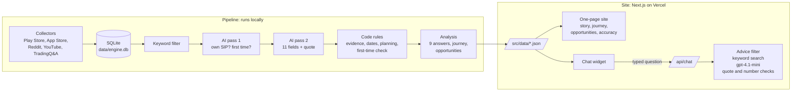
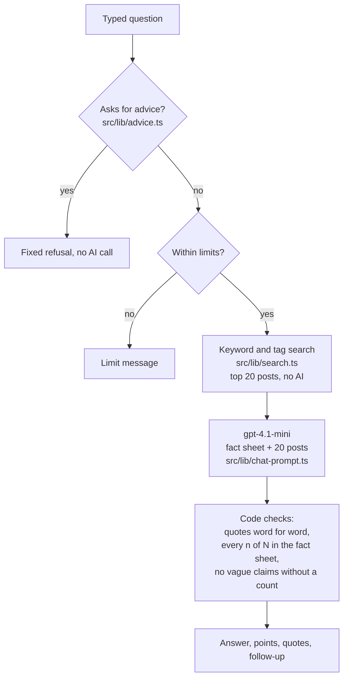

# Architecture

How the SIP Discovery Engine is built: what runs where, how data moves from a public post to a number on the site, and where each quality check sits. The checks and their results are in the AI Evidence Log, [EVIDENCE-NOTES.md](EVIDENCE-NOTES.md).

## The big picture

Two halves, joined by a set of JSON files:

- **The pipeline** runs on a laptop, never on the server. It collects posts, tags them with AI and counts the results. It needs the OpenAI key and the local SQLite database.
- **The site** runs on Vercel. It reads only the exported JSON files, so a deploy never re-runs collection or tagging and costs no tokens. The only AI call on the server is the chat answering a typed question.

## 1. Collection

| Part | File | What it does |
|---|---|---|
| Collectors | `scripts/collect-*.mts` | One per source. Play and App Store reviews of five investing apps, six Indian investing subreddits (posts and comments), comments on the most-discussed SIP videos on YouTube, TradingQ&A threads. From 1 January 2024. |
| Source lists | `src/pipeline/sources.ts` | Apps, store ids, subreddits and how much to pull from each. |
| Network | `src/pipeline/http.ts` | Fetch with retries and polite pacing. |
| Storage | `src/pipeline/db.ts` | SQLite through Node 24's built-in `node:sqlite`, WAL mode. Tables: `posts` (one row per post, with source, app, date, text, keyword result), `runs` (one row per collection run), `labels` (every answer from every rater: AI passes and checks), `ai_runs` (every AI run with its token use). No usernames are stored. |
| Long runs | `scripts/run-awake.ps1`, `scripts/collect-queue.ps1` | Keep the laptop awake during a run, log progress, restore sleep after. |

## 2. Filter

`src/pipeline/keywords.ts` keeps posts that mention SIPs, mutual funds or investing, before any AI sees them. A comment also passes when its thread or video title is about SIPs, and Reddit comments are only collected from SIP story threads, so all of them pass (the rule sits in `src/pipeline/db.ts`). A recall check (`scripts/recall-sample.mts`, `scripts/recall-check.mts`) reads a sample of what the filter dropped to measure what it misses.

## 3. AI pass 1: is it about their own SIP?

`src/pipeline/ai/pass1.ts` holds the instructions and the answer schema (gpt-4.1-mini, structured output). For each kept post: is it about the writer's own SIP (relevant), and are they a first-time investor? Run by `scripts/pass1-run.mts`; Reddit is read as a fixed random sample. Versions were checked against blind labels before each full run (`scripts/pass1-test.mts`, `scripts/compare-raters.mts`).

## 4. AI pass 2: the 11 fields

`src/pipeline/ai/pass2.ts` is the single source of the pass 2 instructions. The pipeline and the site import the same file. For each relevant post in a fixed sample (`scripts/pass2-run.mts`, seed 2050) it records the journey stage, why they started and who influenced them, what they expected, what happened, the trigger, what they check and how often, in-app confusion, where they went outside the app, segment (income, age, source of money), the app, the theme (one of 12 frozen unmet needs in `src/pipeline/themes.ts`), the need in one sentence, and an exact quote.

Posts go 8 to a request with a hard token cap. A batch that comes back cut off or broken is split in half and retried, down to single posts.

## 5. Code rules: the AI's answers are checked, not trusted

These run in code on every answer, cost nothing, and are the main reason the tags can be trusted. Each was added after a check found a problem (see the corrections in the Evidence Log).

| Rule | Where | What it does |
|---|---|---|
| Evidence | `readPass2` in `pass2.ts` | Every fact must come with words copied from the post, containing a word that supports it. If not, it becomes "not stated". |
| Quote check | `quoteMatches` in `pass2.ts` | The quote must appear in the post word for word. |
| Fund-picking requests | `applyT10Rule` | A request for a portfolio review counts as "help me choose funds", except in store reviews and beginner "where do I start" questions. |
| Advice to others | `applyAdviceRule` | A reply with no "I" or "my" and no question carries no need of its own. |
| Asking outside the app | `applyOutsideRule` | A post on Reddit or YouTube that asks something counts as asking there. |
| Dates | `applyDateRule` | The stage is worked out from a start date or "N months" in the post and the post's own date. |
| Planning | `applyPlanningRule` | "Planning to start" posts get the stage "before starting". |
| First-time check | `src/pipeline/first-time.ts` | A post past 12 months that never says it was their first SIP is counted as experienced. |

`scripts/reapply-rules.mts` re-runs the code-only rules on saved answers, so a new rule needs no new AI run.

## 6. Analysis and export

`scripts/analyse.mts` turns the tags into the files the site reads:

- `answers.json`: the brief's nine questions, each with a headline, its base ("from N posts that say this"), points, charts, quotes and a link to the posts. Numbers come from first-time posts when 30 or more state the field, otherwise from all posts, and the answer says which. Below 30 posts it shows counts only.
- `journey.json`: each stage's posts, drop-off share and top need.
- `opportunities.json`: every theme at every stage (an opportunity area) with reach, how it ends, the top trigger, sources and the team's "within the rules" call.
- `posts.json`: the tagged posts, trimmed, for the browse page and the chat's search.

`scripts/export-site.mts` writes `overview.json` (the funnel by source) and `accuracy.json` (golden set and holdout scores, other checks).

## 7. Evaluation

| Check | Script | Data |
|---|---|---|
| Golden set: 30 posts, answer key drafted blind and reviewed by the team | `golden-pick.mts`, `golden-page.mts`, `golden-run.mts`, `golden-score.mts` | `data/golden-2070*` |
| Holdout: 20 fresh first-time posts the fixes never saw | `holdout-pick.mts`, `golden-score.mts --set holdout-2071` | `data/holdout-2071*` |
| AI judge reviews of pass 2 themes and chat answers | `pass2-test.mts --review`, `chat-test.mts` | `data/review-*`, `data/chat-review-*` |
| Date rule unit cases | `date-rule-test.mts` | in the script |
| Advice filter cases | `advice-test.mts` | in the script |

The pass bar is 80% agreement on the key fields (stage, what happened, trigger, theme). Results and what is below the bar: [EVIDENCE-NOTES.md](EVIDENCE-NOTES.md).

## 8. The site

Next.js (App Router, TypeScript, Tailwind), one page plus a posts browser.

| Part | File |
|---|---|
| Layout, fonts, header | `src/app/layout.tsx`, `site-header.tsx`, `logo.tsx`, `globals.css` |
| Page sections | `page.tsx` (order), `story.tsx` (hero, findings, how it works, journey), `opportunities.tsx`, `accuracy.tsx`, `charts.tsx` |
| Posts browser | `src/app/posts/page.tsx` (filters are query parameters, so every "see the posts" link lands filtered) |
| Chat state | `chat-state.tsx` (context and types), `chat-provider.tsx` (open and close, messages, first-visit greeting, `?q=` deep links) |
| Chat widget | `chat.tsx` (launcher, greeting, docked panel on desktop, full screen on phones, suggestions, typed questions) |

The page is mostly built ahead of time. Only the part that reads a `?q=` link waits for the request, inside a Suspense boundary.

## 9. The chat

Two kinds of answer:

1. **The nine brief questions** come straight from `answers.json`. They are instant, cost nothing and always match the page.
2. **Typed questions** go to `POST /api/chat` (`src/app/api/chat/route.ts`):

The fact sheet is built from `answers.json` and `journey.json`, so the chat's numbers are the same as the page's. Anything that fails a check is dropped and the reply says how many items were removed. Limits: 15 questions per visitor and 100 per day, kept in server memory (they reset when the server restarts, so they are not a firm cost cap).

## 10. Deployment

- GitHub repository, deployed on Vercel from the `main` branch.
- One environment variable on Vercel: `OPENAI_API_KEY`.
- Not deployed: `data/engine.db` (too large, and it holds the raw scraped posts), `.env`.
- Updating the numbers: run the pipeline steps locally, commit the changed `src/data/*.json`, push. Vercel rebuilds the site.
